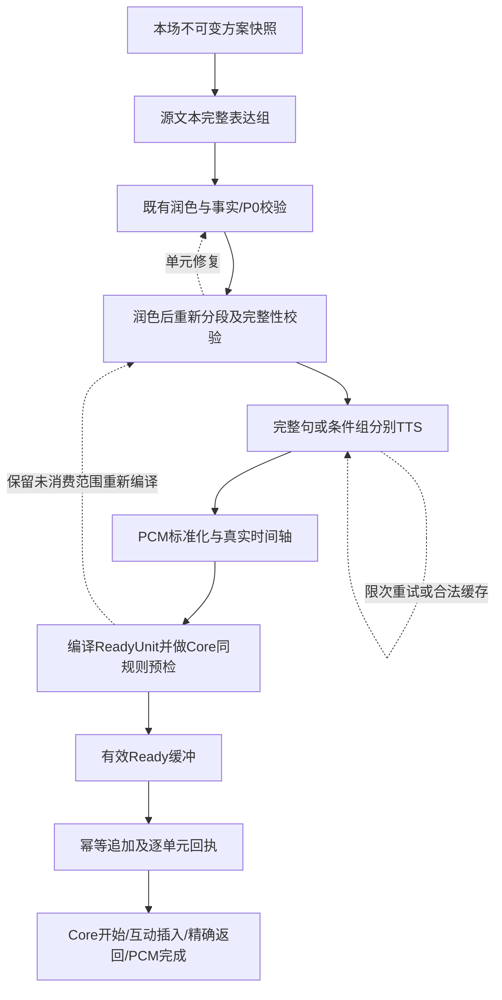

# 话术优先：安全切点与连续供料根治方案

日期：2026-10-22。交接对象：DeepSeek。状态：**技术设计，尚未实施、尚未部署**。

本方案以场次446的真实故障为回归样本，固定复核源码至 `a2b3db4`；其中 `e2f8eac`、`a2b3db4` 的切点合同做了离线函数回放。源码提交状态不能代替生产部署状态，本文不宣称这些后续补丁已在真实直播中通过。

## 一、结论：应该改造什么

**根因是系统没有把“完整话语、合成片段、播放音轨、可插播位置”建成一致的数据合同。** 当前用固定字数切输入，用一次TTS返回作为时间轴的一段，再用最后一个标点判断整段能不能切；任何准备错误又直接退出整场生产者。于是同一个问题会轮流表现为归档失败、切点非法、互动没有入口或整场停播。

根治的改造对象是“话术到可播放单元”的编译链路和生产者的故障边界。保留现有方案、事实工厂、声音网关、Core顺序追加及会话归属保护，在它们之间建立统一的 **SemanticPlan → AudioPiece → ReadyUnit** 合同。

完成后的系统必须做到：

1. 先确认一句话或一组条件说完整，再合成；润色改变了句子，必须重新分段。
2. 每个切点同时有语义依据和真实音频位置，Management与Core使用同一套校验规则。
3. 一段正在准备的内容失败，先在该段内恢复，已有合法声音继续播放；只有确认无法在剩余有效缓冲内恢复，才结束本场。
4. 主线、字幕、缓存、互动返回位置引用同一份正文和时间轴，不能各自猜测。

“加句号”“缩到110字”“所有尾部标A”“没点就跳段”都不能作为最终实现。

## 二、已经确认的事实

### 2.1 场次446的故障链

固定租户14／房间29／设备7，正式版本204；Management运行源码 `471178a`。以下时间均为北京时间：

| 时间 | 已观测事实 | 能证明什么 |
| --- | --- | --- |
| 15:45:31.394 | 场次446启动 | 本场开始 |
| 15:45:31.450 | 读取4个标签、33个源文本分段 | 使用的是多标签话术优先链路 |
| 15:45:35.025 | 首个润色段48字 | 首段生成成功 |
| 15:45:35.277 | Core节目创建、首块提交成功 | 已进入Core链路；不能据此声称完整PCM播完或实机出声 |
| 15:45:35.280—15:45:36.653 | 第二份润色请求完成，110字、无模型调用错误 | 有正文；不是模型空返回 |
| 15:45:42.070 | 本场停止，原因 `formal_mainline_failed` | 开始至停止10.676秒 |
| 15:45:42.084 | 正式生产者记录“正式声音没有可用语义安全切点” | 直接触发点在后续声音准备，不是首段没有生成 |

443、444也出现相同失败。446启动前的设备断开和重连，不能替代这条已明确的后端故障链，本文不把它归因为盒子掉线。

第二份实际正文有两个内部句号，最后一句没有终止标点。整段一次合成后只产生一个timeline片段，`strongFullShowVoiceCut()`只检查末字，因此两个内部句界完全没有进入音频时间轴。110字限制对此没有帮助。

### 2.2 后续补丁的真实边界

| 提交／措施 | 解决范围 | 仍然存在的问题 |
| --- | --- | --- |
| `471178a`：跨标签使用全局block编号 | 避免不同标签音轨编号冲突 | 不修复语义分段或切点 |
| `a734c54`：润色最多110字 | 限制长度膨胀 | 110字也可以没有末尾标点；更不能提供内部句子的音频位置 |
| `adf8e94`：合块无切点时缩块／跳段 | 增加合块层包装 | 实际446在单段 `synthesizeRecordingStreamSegment → archiveFullShowVoice` 已报错，尚未进入该包装；合块函数报错也直接返回，无法走“空切点缩块”分支 |
| `e2f8eac`：无标记时按timeline尾部补点 | 绕过部分Management空点情况 | 实际110字样本补出1个点，Core仍以“不符合句子边界”拒绝；已离线复现 |
| `a2b3db4`：补点增加末尾标点检查并排除最后段 | 避免上一个补丁提交明显非法点 | 实际单片段110字样本仍为0点，现有归档空点硬错误仍在；“返回空后上层跳过”没有跨过单段归档这道错误边界 |

另有一个可读出的风险：缩块只消费部分内容时，标签最后一次循环没有独立的排空循环，剩余内容可能没有提交。**这是源码风险，不是已证明446发生了丢句。** 根治时应改用显式消费游标与覆盖账本，禁止靠“成功返回空track”表达跳过。

回放使用真实正文、从固定Git提交抽取的原Go函数及等形数据结构；10秒范围仅用于合同测试，不是该音频的实测时长。没有连接生产、调用模型或TTS。给正文补句号的对照仅证明当前规则依赖末字，不是推荐上线修法。

## 三、先建立五条不可破坏的合同

### 3.1 完整性合同

每次调度消费一个“完整表达组”，保留源标签ID、源文本范围、实际润色正文、事实与条件依赖。准备失败不能悄悄把它当已播。

例如“337元，需提前预约，节假日不可用”可以分句合成，但不能在价格后插入一长段互动，把限制条件遗失。用 `meaning_group_id` 关联必要条件；只有组内允许的边界才开放互动。标点是候选边界，不是完整性的充分证明。

### 3.2 音文一致合同

`spoken_text` 必须是实际送入TTS的正文。字幕、缓存命中展示、归档、互动的前后文都引用它。源原文另存 `source_text`，不能拿原文覆盖润色后的声音字幕。

当前复用分支从 `tab.versions[index]` 取旧音轨，却把 `entry.Text` 设为原始 `segment.Text`；后续合块按这个Text生成timeline。这会使旧润色声音与新组合字幕不一致。必须把“实际正文＋音频＋时间轴”作为一个缓存对象复用。

### 3.3 时间合同

时间位置以最终标准化PCM的样本帧数为准。不能按字数比例、TTS请求耗时或整段音频平均分配句子时长。格式、语速或停顿改变，时间轴必须重建。

### 3.4 能力合同

分别记录：

- `playable`：音频格式、非空有效声音、时长和正文匹配检查通过。
- `interruptible`：至少有一个经验证的语义切点，而且互动结束有明确返回位置。

中间合成片段可以是可播放但暂不可插入的材料；它不应冒充最终正式音轨。第一阶段仍只把满足当前Core合同的ReadyUnit送入正式队列；未来支持不可插播音轨时，必须显式扩展合同并测试，不能只删除归档拦截。

### 3.5 生命周期合同

一次准备失败是单元事件，不天然是整场事件。手动停止、暂停、版本替换、旧生产者失去归属是生命周期事件，也不该被包装成合成错误。保留当前 `expected_boot_id`、运行代次及session归属检查，禁止恢复逻辑复活已结束直播。

## 四、目标链路与模块责任



| 模块 | 输入／输出 | 不承担的责任 |
| --- | --- | --- |
| SemanticPlanner | 源标签快照→完整表达组、源范围、依赖 | 不处理音频毫秒 |
| RewriteAdapter | 表达组→润色正文及候选句组，携带完整有效P0和四层规则 | 不决定播放成功 |
| SemanticValidator | 校验范围、顺序、条件、引用和允许切分位置 | 不仅凭句号声称语义全部正确 |
| AudioCompiler | 句组→PCM片段→带真实timeline的ReadyUnit | 不决定整场停止 |
| SupplySupervisor | 有界准备、缓冲、重试、状态推进、错误升级 | 不绕过事实／声音／切点准入 |
| Core | 验证并消费ReadyUnit、维护播放游标和互动返回 | 不猜测模型正文内部的音频位置 |

这是在现有模块间建立共同合同，不要求推翻整个系统。优先复用PCM检查、顺序append、现有互动调度和归属保护。

最低数据结构可按以下清单实现；字段分属不可变manifest与可变运行账本，不能混在一份随重试不断改写的缓存里：

| 对象 | 必要字段 |
| --- | --- |
| SemanticPlan | schema版本、快照ID、稳定标签ID、源范围、表达组ID、实际正文、事实／规则依赖、允许插入边界 |
| AudioPiece | 正文哈希、音色／模型／语速／情感指纹、PCM格式、样本帧数、媒体内容哈希、稳定资产引用 |
| ReadyUnit | 编译器／合同版本、按序AudioPiece引用、累计帧边界、timeline、safe points、完整返回位置、manifest摘要 |
| ScheduleOccurrence | 本场运行身份、调度单元ID、轮次／组序、ReadyUnit引用、提交摘要、重试／回执／开始／完成状态 |

三个游标分别保存：已编译到哪里、Core已确认排队到哪里、真实PCM已完成到哪里。任何一个游标都不能替代另外两个。源覆盖账本同时表达“已排队／已完成／仍待恢复／按批准策略省略”，不只存一个成功计数。

## 五、语义分段：在合成之前解决，不在音频归档时猜

### 5.1 两次分段各有用途

1. **源文本分组**：读取本场快照中的稳定 `tab_id`，按完整意思形成润色输入。40—80字可以作软目标，不能作强行截断条件。长句、条件尚未结束时向后延伸；达到成本或长度上界仍无法形成完整组，进入明确的修复／配置失败路径。
2. **润色后分段**：模型可能改句序、扩写、增加句子，必须对实际输出再编译。不能沿用原分段，也不能把一份多句输出压成一个只有尾部可切的timeline项。

现有 `recordingStreamTexts()`只返回字符串数组，丢掉了标签的持久身份；新入口应返回包含ID、标题、正文、源范围的结构，不能用本轮随机顺序充当标签身份。

### 5.2 输出协议与验证

建议在既有润色请求上增加版本化结果协议，不强制每句再多调用一次模型：

```json
{
  "schema_version": 2,
  "source_group_id": "g17",
  "spoken_units": [
    {"id": "u1", "text": "完整口播句。", "meaning_group_id": "g17", "cut_after": true},
    {"id": "u2", "text": "与上句关联的使用条件。", "meaning_group_id": "g17", "cut_after": true}
  ]
}
```

`cut_after`只是模型建议，最终由程序结合表达组依赖和共用边界规则批准。协议不合格、内容缺失、出现新价格或条件丢失，不能因JSON能解析就采纳。采用可定位的源范围／来源ID做覆盖核对，避免单纯拼接文本相等错误否决合法改写；确定性事实检查与现有事实审核共同承担完整性检查。

旧纯文本返回先经版本适配器处理；句号、问号、引号与括号闭合、数字小数点等都应有明确规则。没有末尾标点但语义完整的文案，可以在合成前经同一规范化器形成规范正文；不确定的尾句应与后文完整组一起修复。**不能在已经合成的音频上追加一个句号，就宣称音频边界真实成立。**

价格、规格、预约、售后等事实及限制条件不因分段／改写被删除；四层提示词中的“要说、不说、如何改写”继续生效。不能为制造切点另开绕过P0的提示词。

## 六、音频编译：让语义边界有真实坐标

### 6.1 当前可落地的首选

现有 `ttsgateway.SynthesizeResponse`只有音频URL及声音参数，**没有词／句时间戳**。因此首选方法是：

1. 将经验证的完整句或不可拆条件组合成一个AudioPiece；需要句内交互边界时再拆成独立完整句合成。
2. 解码并标准化为统一PCM格式，记录每片最终样本帧数、正文哈希、声音配置哈希。
3. 通过拼接PCM形成较长的Core track；每片末尾的位置由累计样本帧数换算，不靠字符估计。
4. 片间需要的自然停顿计入真实PCM；归属前句时同步延长该句EndMS。时间轴Index根据实际语音项连续编号，不能用含静音片段的原数组下标跳号。
5. 将允许插入的句末映射为safe point，保留正确的下一句／下一轨返回位置。

这样既保留长音轨的自然衔接和互动回归，又保留内部句界。**不是重新退回“每条短句独立成一个Core track，互动结束只能跳下一条”的实现。** 合成片、语义句、Core track是三种不同单位。

逐句TTS会增加请求数并可能影响语气连贯，需要复用现有连接和有限并发，并通过完整语调组、缓存、适度拼块控制。先证明正确，再按实测时延优化批量。若以后提供商能返回可验证的句级时间戳，可让一个请求输出多句；若采用强制对齐，应有可靠度门槛和失败退路，不能把每段ASR作为当前必选关键路径。

当前Core未来窗口最多32轨，累计覆盖达到约90秒后停止扩展；自动互动A/B准备机会还要求至少24秒提前量。因此不能只用“缓存有45秒”判断互动一定可用，也不能把大量极短句各做一轨耗尽32轨窗口。编译器按实际时长适度拼接多句track，并单独观察“有可用切点且切后有返回内容”的有效机会。

### 6.2 合同校验放在上传和送播前

编译器输出前校验：

- PCM格式一致、帧对齐、时长合法、有效声音非空，WAV声明与实际数据一致。
- timeline与实际正文一致；编号连续、时间单调、无重叠，停顿归属明确，范围不超实际音频。
- 每个切点对应已批准的语义边界，坐标与timeline片段末尾一致；禁止尾部统一标A来绕过检查。
- 该批全部已消费源范围有对应单元，剩余范围明确保留，无漏段和越序。
- 当前返回位置可解析；在音轨尾部插入时必须有已入Core未来窗口的下一轨，不能使用尚未提交的本地缓存作返回依据。

Management与Core抽出**同一版本的纯合同校验器**，使用同一组fixture；可以放入现有公共模块或独立小型Go模块。含引号的句末、分号、英文句号、小数点等规则一次修正，两端一致更新。协议版本不兼容明确拒绝，不能由两端各自宽松兜底。

媒体片段存储与正式音轨发布分开：`StoreAudioPiece`允许保存待组合的合法片段；`PublishReadyUnit`必须通过完整合同。不让中间片段为了入库而伪造safe point，也不全局移除正式音轨防线。上传临时对象、清理和发布状态应幂等；先做本地校验，减少反复上传再删除。

## 七、连续供料：改掉“任意error退出整场”的控制流

### 7.1 单元状态与本场状态分开

单元状态建议：

`PLANNED → REWRITTEN → SYNTHESIZED → VALIDATED → READY → APPEND_PENDING → QUEUED → STARTED → PCM_COMPLETED`

失败分支使用 `RETRY_PENDING / REPAIR_PENDING / REJECTED / ACK_UNKNOWN`，不能用空track或nil错误表达“已经处理”。只有明确排入队列／按业务确认消费才推进覆盖游标。恢复失败保留该源范围和原因。

本场状态保持现有权威归属，由SupplySupervisor维护 `PREPARING / RUNNING / RECOVERING / TERMINATING`。单元失败先进入恢复，只有Supervisor返回确认的不可恢复错误，才调用现有整场退出处理；不能让worker返回的普通error直接触发 `handleLiveAnchorProducerExit()`。

### 7.2 错误必须有类型、范围和处理动作

| 故障 | 范围 | 处理原则 |
| --- | --- | --- |
| 润色协议不完整／未形成句界 | 当前表达组 | 重做完整组／重新分段；不先调用TTS制造必失败资产 |
| 瞬时TTS或存储读取失败 | 当前AudioPiece | 有截止时间的少量重试；满足相同正文、事实、声音合同才可取缓存 |
| PCM损坏／时间轴不一致 | 当前合成版本 | 拒绝该版本、重合成／重编译；不得把格式校验失败降格放行 |
| 没有可插入点但媒体有效 | 当前编译单元 | 回到组装层处理；本阶段不提交不兼容正式单元，也不直接停止已有主线 |
| append超时，回执不明 | 当前提交 | 先查权威回执或相同ID重试；不能换ID再发导致重复播放 |
| Core拒绝合同／相同ID不同内容 | 编译器或提交器 | 熔断同类坏提交，保留诊断；不能无限重试同一非法负载 |
| 会话／版本／运行归属已改变 | 当前旧生产者 | 立即结束旧工作并丢弃迟到结果，不标成声音故障，不停止新会话 |
| 用户停止或暂停 | 生命周期 | 遵从权威状态；不重试复活，不消费尚未提交内容 |
| 音色权限或关键配置确实无效 | 本场配置 | 无合法替代则准确终止，不私换音色 |

错误对象至少带 `stage、scope、retryable、unit_id、source_group_id、attempt、cause`；用于后台诊断。重试次数和总截止时间由Supervisor统一控制，不允许模型层、下载层、worker各自重试叠加成无上限等待。

建议首版每类瞬时错误最多2次重试、完整组修复最多1次，且总预算受“剩余有效缓冲－安全余量”约束；这些是待调参数，不是已实测可保障的服务指标。事实缺失、用户终止、所有权变化和合同确定不兼容不按瞬时错误重试。

### 7.3 缓冲按有效声音计算

现有45秒低缓冲阈值可作为改造起点；增加高水位、最大在途数、最大字节数，基于实测生成尾延迟调整。启动尽量准备首个完整ReadyUnit并并行补第二个；是否等双单元才正式启动由启动时延目标控制，不能承诺首次开场零等待。

缓冲只计算已验证、属于本场、可按顺序消费的声音；合成中、被拒绝、已重复去重、回执不明的内容不计。当前播放剩余时长与未来队列不能重复相加，暂停期间不按墙钟错误扣光。

供料健康与播放健康分开监督：若队列非空但当前任务PCM游标长时间不推进，应检查该任务的媒体下载／解码／输出错误，不能因“有缓存”判正常，也不能仅因一段静音就断言系统停播。超时判断结合暂停、互动占用、预定停顿和任务身份，阈值由实际帧推进与网络延迟确定。运行状态恢复前先向Core对账；无法确认旧任务是否已经播放时，不从第一句自动重播。

恢复顺序：继续消费已排队的合法主线 → 修复当前未消费表达组 → 命中同一合同的合法缓存 → 在预算耗尽且确无有效供料时准确终止。不得用无意义“稍等”无限循环掩盖断供，也不跳过关键商品条件去播下一段。

如果缺失片段是可独立省略的非关键冗余，必须由事先定义的内容策略批准省略并记账；默认所有业务内容不可静默跳过。首开要求新生成时，不能用旧开场缓存兜底假装满足。

## 八、提交、互动回归和缓存必须一起对齐

### 8.1 稳定身份与幂等

建议ReadyUnit的身份至少包含本场运行身份、方案快照、稳定标签ID、轮次、表达组序号、输出变体；**调度发生身份与缓存资产身份分离**。同一资产下一轮合法复用是新的调度单元；同一次append重试必须沿用同一unit ID和相同负载。

现有Core append已经有ID＋负载摘要检查，应继续使用。当前append对连续完全重复内容可能“记住ID但省略入队”，所以HTTP成功或Generation返回不等于该声音实际排队。需按unit返回 `queued / already_queued / omitted / rejected` 等内部结构化结果，并提供权威查询以解决超时不明；这些内部枚举不直接显示给普通用户。

随机签名URL不能在同一次重试时重新生成成不同负载；固定提交清单并在有效期内重试，或改用稳定资产引用、由Core取授权地址。过期后更换引用必须走显式替换合同，不能悄悄以同一ID改变内容。Core重启后若无法恢复权威回执，明确停止／对账，不承诺跨进程的“恰好一次播放”。

本地Ready队列和Core队列分开记账。Core开始只证明开始，PCM完成才推进相应完成账本；实际盒子外接声音需要设备侧证据，不能由开始／完成回执推断。

### 8.2 自动互动不能再次被主线改造堵住

场次424已经证明，自动互动需要可读取的未来窗口及返回位置，人工抢答可绕过部分准备门槛。根治时必须保留现在的顺序append，不退回只把下一段存入refresh替换区。

一次互动插入以 `program + track + cut + resume` 为合同：先确认切点可用和后续可恢复，再领取；播放结束按已锁定的返回位置恢复，不根据临时数组下标猜下一句。队列裁剪、追加、暂停和节目切换不能改变这份身份。候选过期须释放或重新规划，不带旧cut跨节目播放。

预选位置不等于执行授权。保留Core已有的当前任务身份校验、切点预留、真实PCM到点等待及陈旧任务拒绝；互动结束要等实际主线PCM恢复再确认完成，不用预计音频时长的定时器假定已经切入或返回。

长句、价格条件组等暂时没有安全点时应报告“等待合适的插入位置”，而不是“没有观众互动”；自动任务到期、合并、延后都要可查。人工抢答也必须保留事实和媒体合同，不能借人工来源放行非法时间轴。

### 8.3 复用对象与业务比例

缓存以一份不可变manifest保存：实际润色正文、语义计划、完整音频、时间轴、安全点、实际音频时长、编译器／合同版本、声音元数据及内容哈希。键包含租户／方案范围、源表达组及相关事实／规则指纹、风格、模型、音色、有效语速、情感指令与音频格式。默认语速0应规范成实际1再计算指纹。

事实或价格条件变化，只使依赖这些事实的单元失效；声音参数变化使对应音频失效，正文能否复用由文字合同另判。不能只比较同一标签标题／数组下标，也不跨方案借库存。

旧缓存没有足够证据证明音文与切点一致时，先校验／重编译，不能默认升级为v2安全资产。内部素材缓存无需每次下载、正式归档、再下载合并，资产读写可以在正确性成立后优化。

保留两类业务各自规则，不趁架构改造混用比例：

- 当前话术优先源码：每标签前4轮全部刷新，第5轮起30%向上取整、至少1段刷新，余下取该段最近4个版本；这是当前实现口径，不宣称等于全场70%。分段数量很少时，向上取整会明显偏离七三目标，需单独列为产品决策。
- 实时主线的首次开场新生成、后续七三调度：沿用该模式的有效采纳及排除规则，不能把旧监控口径直接套到话术优先。

拆出更多AudioPiece不能增大“30%刷新”或“前4轮”的业务分母；以稳定源表达组记刷新，合成分片只作技术实现。库存构建成功可以入库，但不能计为已播次数；复用选择、实际排队、Core开始、PCM完成分别记账。

## 九、故障显示：对用户说中文，对后台保留准确位置

当前错误分类会因“声音”二字把切点错误归为“声音配置”，这与实际故障不符。用结构化stage替代字符串猜测，不把全部问题归到TTS或配置。

普通用户界面只能显示中文说明和可用的场次数字，例如：

- 恢复中：“下一段声音正在重新准备，当前内容继续播放。”仅在确有有效播放内容时使用。
- 等待互动位置：“这条回答正在等待合适的插入位置。”
- 无法恢复：“后续话术的声音分段校验未通过，重试后仍无法继续，本场已停止。场次：446。”

不直接拼接Go错误、英文提供商返回、内部枚举、路径或请求代码。后台受控日志按同一诊断事件保留阶段、源范围、重试链和拒绝原因；凭据、签名URL仍脱敏。恢复中与最终停止各记录一次状态变化，避免页面持续弹同一错误。

## 十、给DeepSeek的实施拆分和顺序

### PR1：先把一份声音编译正确

修改重点：

- [recording_stream.go](E:/直播伴播/management-service/internal/httpapi/recording_stream.go)：源分组适配、润色后分段、完整组TTS编译入口。
- [recording_stream_tabs.go](E:/直播伴播/management-service/internal/httpapi/recording_stream_tabs.go)：保留标签ID、实际正文缓存、覆盖游标，移除静默跳段作为成功的表达方式。
- [live_agent_plan_voice.go](E:/直播伴播/management-service/internal/httpapi/live_agent_plan_voice.go)：区分中间片存储与最终发布，基于PCM片段生成timeline，上传前校验；保留其它正式声音使用者的合同。
- [client.go](E:/直播伴播/core-service/internal/coreaudio/client.go)：与Management共享或等价验证同一版本合同，禁止单边“放宽”。

新增纯SemanticPlan／AudioManifest／合同校验模块与离线fixtures。完成条件：实际446正文经过新编译可产生真实句界；不补假点、不放松Core、不靠删句通过。先使用伪TTS和标准PCM验证结构，真实声音听感与时延另验。

### PR2：让生产者具备单元恢复能力

在PR1合同基础上增加SupplySupervisor、单元状态、错误范围、有界修复、有效Ready缓冲。关键是**在单段合成／归档报错位置捕获并决定恢复**，不是只在外层combine包装。

复核 [anchor_generation_exit.go](E:/直播伴播/management-service/internal/httpapi/anchor_generation_exit.go) 与 [anchor_live_supply.go](E:/直播伴播/management-service/internal/httpapi/anchor_live_supply.go)：保留归属和条件停止，只有最终不可恢复错误进入整场退出。同步 [detail.go](E:/直播伴播/management-service/internal/errordetail/detail.go) 的准确分类与中文公开文案。

### PR3：把提交、缓存和互动接成同一条账

复核 [program_append.go](E:/直播伴播/core-service/internal/coreaudio/program_append.go) 的逐单元回执、去重与超时对账；联测 [interaction_preparation_window.go](E:/直播伴播/core-service/internal/httpapi/interaction_preparation_window.go) 的未来窗口、领取、插入和返回。缓存manifest迁移及业务计数在此完成，不用“返回200”证明复用落地。

每个PR必须能单独回放验证，不能PR1还不合格就用PR2不断重试掩盖。合同版本切换成套进行，保留旧直播快照，不在正在运行的节目中途混入新编译规则。

## 十一、验收矩阵：证明整条链路成立

以下是**待实现的验收要求**，不是本次已全部通过的结果。

| 场景 | 必须满足的结果 |
| --- | --- |
| 446实际110字正文：内部有句号、末尾无标点 | 合成前修复／重分组；内部完整句有真实PCM边界，未完尾句不静默丢弃 |
| 整段无标点、超长句、句末引号／括号、小数点／版本号 | 不按固定字符硬切，不把小数点当句界；两端校验一致，无无限修复 |
| 价格＋预约／核销／节日限制分布在多句 | 必需条件完整保留，互动不破坏必须相邻的条件组 |
| UTF-8、同字重复、合法润色改写、多个标签重排 | 源范围身份稳定；不按字符串局部匹配导致覆盖错位 |
| 静音片、采样率／声道差异、片间停顿 | 标准化后帧数正确、Index连续、范围合法；不把纯静音当正文 |
| 第2段一次TTS失败，已有足够缓冲 | 当前合法主线继续，限次恢复后按原序追加；不停止整场、不越过当前组 |
| 队列有内容但媒体读取失败／PCM游标不推进 | 定位播放侧故障；不以缓存非空宣称正常，不靠预计时长伪造完成 |
| 所有恢复均失败、缓冲耗尽 | 有界结束并准确中文告知；不空转、不伪造播放、不无限“稍等” |
| archive失败、上传成功但落库失败 | 临时对象及状态可清理／对账，无半成品被当Ready |
| append服务端已接收、客户端超时 | 相同ID与内容重试／查回执，无重复播放；去重省略不记成入队 |
| 同ID不同内容、签名URL变化、Core进程重启 | 显式拒绝或对账，不以新ID盲重放、不误称恰好一次 |
| 准备线程乱序完成／标签最后缩块剩余 | 按序消费、尾部排空；源覆盖无漏段、重播、越序 |
| 自动互动、人工抢答、轨内返回、轨尾返回 | 有合法future window，回答一次后恢复正确位置；不跳掉尚未播放的业务句 |
| 互动准备后暂停、节目切换、队列裁剪 | 旧cut失效，不跨节目插入；恢复位置不依赖会变的数组下标 |
| 用户停止／旧生产者迟到／新场已启动 | 旧任务不追加、不关新场、不写错误归因、不自动绑定未来场次 |
| 原文与润色不同的旧音频复用 | 页面／SRT／timeline显示实际声音文本，校验哈希一致 |
| 事实、语速、音色、情感、规则变化 | 相关缓存正确失效，不为命中绕过事实或声音配置 |
| 不同商品／类目、多个方案、新旧快照 | P0与四层约束保持，租户／方案隔离，无当前商品专用补丁 |
| 4轮刷新与后续30%、七三模式首开 | 两模式独立记账；技术分片不改变业务分母；首开要求不被缓存绕过 |

验证分三层：纯函数与伪依赖故障注入 → 本地Core真实PCM链路 → 经单独授权的固定场次灰度。后两层必须核对实际回执和时间轴；盒子外接声音另做实机验收。无需为了验证控制流批量调用付费模型或TTS。

灰度观测至少包括：单元修复率、按阶段拒绝、未消费源范围、断供时长、真实PCM推进、自动互动等待原因、恢复错位、重复提交与重复播放、文字／音频复用分别命中。用实际数据确定水位、并发、时延指标，不把“日志没有error”当验收。

## 十二、上线与回退原则

先影子编译现有脱敏fixture，比较正文覆盖、边界及Core校验；再在本地跑故障回放与PCM链路，最后做固定范围灰度。开关随本场不可变快照固定，禁止运行途中切换新旧编译器。

发布前重新获取实际服务器release及各服务指纹，不能拿本地Git HEAD假定线上版本，更不能用旧包覆盖其它助手的新功能。已有正常运行节目不为此强制重启。

若灰度失败，停止把新合同单元送入旧合同节目，按权威播放游标结束或在下一场回退；不把整条队列倒回首句，不重放回执不明内容。旧资产、旧编译器与新manifest分版本保留到验收结束。

## 十三、证据与相关设计

- [本场管理日志](E:/直播伴播-local/live-interruption-20261022/management.log:5416)：446最终切点错误；5356、5382—5384附近为启动及首段链路。
- [本场模型归档](E:/直播伴播-local/live-interruption-20261022/model-evidence-446.json)：仅使用446结束上界内记录，关键正文记录32836。
- [旧末字检查回放](E:/直播伴播-local/live-interruption-20261022/safe-cut-replay.jsonl)：实际正文false、补句号对照true。
- [e2f8eac合同回放](E:/直播伴播-local/live-interruption-20261022/safe-cut-contract-replay.jsonl)：Management补出点，Core拒绝。
- [a2b3db4合同回放](E:/直播伴播-local/live-interruption-20261022/safe-cut-contract-replay-a2b3db4.jsonl)：实际样本0点，现有Management归档切点门槛不通过；Core单独允许空点不等于整条正式链路通过。
- [回放脚本](E:/直播伴播-local/live-interruption-20261022/replay_contract_cut.py)与[方法元数据](E:/直播伴播-local/live-interruption-20261022/safe-cut-contract-replay-meta-a2b3db4.json)：固定提取原函数、无音频合成；两版Core校验函数与已观测Core源码21288b3相同。
- [场次424自动互动原因](E:/直播伴播/docs/2026-10-22-给DeepSeek-场次424自动互动未播原因.md)：未来窗口与人工／自动路径差异。
- [四层结构与事实工厂](E:/直播伴播/docs/2026-10-19-主线话术四层结构与事实工厂-定稿与落地交接.md)：分段、重写与恢复不得绕过的内容边界。

本次只编写方案及仓库外离线回放，未修改业务源码、数据库、方案、队列、提示词或生产配置，未部署、重启、开停直播，也未新增付费模型／TTS调用。
