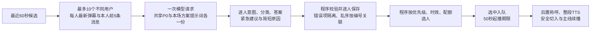

# 互动单人、多人统一批处理

2026-10-31。用户授权“一起改”，随后明确同时支持1人和多人；检测到接口文件并行写入后，用户确认“已暂停，全部交给你整合”。本轮完成源码与本地验证，不代表已发布。

## 业务流程

- 每批1至10人，有1人即可处理，无需凑满10人；沿用调度周期和短暂收集等待，不新增等待凑数的定时器。
- 只有最近60秒内的候选可被准备和选中，达到60秒边界不再领取；不会用更老的弹幕凑满批次。
- 按稳定UID选择每个人最新的一条，前5条上下文按消息条数计算，包含该人原话和已经完成口播的回复；不等同于5组问答，也不包含其他人的历史。
- 昵称、真实UID、场次、任务身份等不交给意图模型。模型只看到本批临时标签U01至U10；程序保存标签与实际任务的对应关系。跨房间、租户、方案和epoch不混批。
- 缺少UID时，不根据昵称猜人、拼接历史或声称已确定是不同用户；同批最多一个匿名候选。
- 语义正文提前生成；只有被选中入队的任务继续走称呼和TTS。其余人保持各自候选期限，不会因为同批生成成功而全部进入执行队列。
- 行为类任务沿用原聚合规则，以单项批次使用同一个内容协议；本轮没有重新设计欢迎配额或欢迎话术质量。

## 模型与程序的分工

模型返回每个人的意图、类型、歧义/澄清句、回答，以及普通/较高/紧急的建议和简短原因，不给整批人强行排名，不决定谁入队。

程序保留原事件通道优先级；语义类内部的默认类别顺序为投诉、催单、下单意向、普通提问、闲聊。一般紧急建议只在类别内有限加权；只有“投诉＋紧急＋明确原因”同时满足且紧急通道已启用，才由程序规则升级至原紧急通道，可撤销尚未播出的普通任务，仍不抢占正在播放的内容，也不越过语义次数配额。

同级先照顾近期没有实际回应的人，再比较等待期限和稳定接收顺序。模型的排序倾向不能绕过过期检查、去重、正在播放保护、启用状态、音频时长预算或次数配额。原先把文本的粗粒度下单/负向提示直接分流的做法取消，文本先统一交模型分类。

## 次数配额与两个期限

近180秒经模型确认的有效语义弹幕按稳定UID去重，同一个UID多次发言计1人，以原事件时间计入。进房、点赞、已播口令参与、未关联口令的纯数字及模型识别的主动互动/刷屏不计入；正在进行的本人澄清对话中的数字可作为有语义回复处理。不同人提出同一句真实问题仍分别计入。分类与播出配额分离，待分类消息不提前抬高语义密度；完整补充见《2026-10-31-主动互动分流与语义计数.md》。

| 最近3分钟不同用户 | 语义互动次数上限 |
| --- | --- |
| 0至4人 | 不另设次数上限，有有效问题即可参与调度 |
| 5至10人 | 任意滚动60秒最多2次 |
| 11至20人 | 任意滚动180秒最多2次 |
| 21人及以上 | 任意滚动300秒最多2次 |

5和10包含在中档，沿用前述讨论口径。不新增30/90/150秒强制间距，也不新增密度降档滞后。

选中待播任务占用配额预留；仅实际起播回执提交次数，重复进度回执不重复计数。起播前失败、撤销或过期释放预留，不消耗已用次数；起播后失败仍计一次。保留原音频时长预算，次数上限不是必须播满的指标。

候选的60秒从原事件计时；选中入队后使用50秒最迟起播期限，并由程序同步更新执行包中的期限。入队失败恢复原候选期限，不提前启动执行时钟；入队后的称呼/TTS/音频重试不刷新50秒。期限前开始的语句可以完整播完，继续受既有播放保护和看门狗管理。

## 提示词、返回解析与错误隔离

- 本场冻结的方案提示词负责业务内容，程序读取 `configs/prompts/anchor-style/interaction-v2-batch.md` 追加任务及分段KV协议。完整冻结P0也在共享系统消息中带一份，后续仍有程序扫描；不恢复旧房间业务规则或改写客户保存的方案提示词。
- 剥离原方案中的旧输出格式章节，保留事实、风格和其他业务章节。现场主线只传一份，个人弹幕和历史分别放在各自输入项中；公共现场补充不会拼进个人原话。
- 每人用编号开始、同编号结束。重复编号、重复字段、缺项、未知编号和截断分别处理，不再存进一个会相互覆盖的字段映射。乱序按本批映射关联，不能凭返回位置猜人。
- 有效个人结果保留；失败项明确返回并进入有限重试/跳过，不冒充已完成。未知编号作为格式问题留痕，不生成额外用户或任务。
- 原单人KV返回保留兼容入口，但同样经过统一解析；重复字段不再静默覆盖。Core正式运行入口对1人和多人都发批次请求。
- 一批只做一次意图/正文模型调用，不额外逐人再请求正文。沿用运营侧指定模型及计费归属，按实际批次调用记录费用，不把一批虚构成10次供应商请求。

## 输出预算与发布前提

请求输出预算为每人900 token，10人为9000。继续尊重后台配置的模型输出上限；容量不足时，在调用前明确返回配置不足，不静默截成单人预算，也不自动更换模型或修改运营配置。真实模型的10人准确率、完整率和耗时仍需另行验收。

旧单人接口继续兼容。新批次传输须同时部署Core、Management及新增MD模板；只部署一端无法构成新链路。上线前仍须按当时实际生产版本整合并执行原发布守卫，不能直接使用本地编译程序覆盖现网。

## 本地验证

最终结果：Core有测试的32个包通过，538个用例/子用例通过；Management有测试的63个包通过，2696个用例/子用例通过、124个环境或付费探针显式跳过；两端均无失败。新增27个顶层测试、合计101个用例/子用例通过。两端全量 `go vet ./...`、Linux amd64编译及本轮代码差异空白检查通过。

验证记录位于 `E:/直播伴播-local/interaction-batch-20261031/verification.json`；完整Go测试事件记录为同目录 `core-tests.jsonl` 和 `management-tests.jsonl`。覆盖1至10人、各自5条历史、逆序返回、缺项/重号/重复字段/未知号/截断、跨房间与epoch、60秒和50秒边界、次数配额分档、失败释放、实际起播幂等、同毫秒新消息、300人突发、匿名身份以及真实Core调度入口至队列的HTTP桩验证。

初次测试夹具中的“第1个人”触发现有P0词表，已改为中性测试文本，未放宽P0。新增P0断言曾放错测试作用域导致测试包编译失败，已修复，失败日志保留为 `management-tests-before-assertion-repair.jsonl`。

本地没有可用的CGO/GCC，竞态检测未运行通过。普通测试与HTTP模拟不能代替真实供应商并发、生产持久化及实机出声验收。没有部署、付费模型/TTS调用或生产队列、配置、方案写入。
