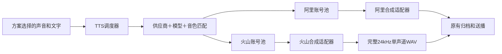

# 火山 Doubao 声音复刻2.0：已有音色合成接入

用户已明确：已有音色 ID，先接入合成。本轮完成本地代码，不包含复刻训练、生产配置、发布或真实付费调用。

## 链路和隔离范围

系统原来已有统一 TTS 网关、阿里账号池和持久化调度队列。本轮把火山加入该调度层，通过供应商适配器注入获准账号的凭据，调度器不再自行组装供应商客户端。

隔离在现有 Management 服务内完成，未新增独立进程或微服务。已有腾讯适配器保留原来的独立调用方式，本轮没有把腾讯迁入账号池。

- 阿里与火山分别匹配账号、密钥、模型、音色映射、限频和并发。不会用阿里 Key 调用火山，也不会把不可用的火山声音换成阿里声音。
- 同一供应商、同一主账号只能登记一次；不同供应商碰巧相同的数字 UID 可以各自登记。
- 同一账号下各模型共享该账号的限频；火山新增“同时合成上限”，跨 Management 工作者在同一数据库锁内核对。
- 当前账号满额后寻找其他兼容账号，兼容账号全部满额才等待。火山的等待请求不会挡住可以运行的阿里请求。
- 沿用现有排队通知、父上下文取消、场次状态核验、队列 TTL 和合成超时。主线在排队期间继续使用当前方案可用缓存；互动声音没有完成前暂缓，不提前打断主线。无有效缓存仍须等待补料。
- 原本的意图挖掘、正文生成、称呼拼接和互动调度不变；新增 LLM 提示词、上下文、调用和自动重试均为 0。

## 配置与使用

### 1. 超级管理员配置 TTS 账户池

在“TTS账户池与调度”添加账号，选择“火山引擎 · Doubao 声音复刻2.0”：

| 字段 | 填写方式 |
| --- | --- |
| 供应商主账号 UID | 火山主账号 UID；不要重复登记同一主账号下的多个 Key |
| API Key | **豆包语音控制台 API Key**，不是火山方舟 Ark 模型 Key |
| 可用 TTS 模型 | `seed-icl-2.0` |
| 方案原音色 ID | 已有 `S_…` 音色 ID |
| 本账号对应音色 ID | 该账号有权限合成的 `S_…`；若就是同一个音色，两栏填相同 ID |
| 每分钟/每秒/同时合成上限 | 按控制台已开通额度填写，不高于实际允许值 |

新火山账号默认采用 30 次/分钟、1 次/秒、同时 1 条的保守值，**这些默认值不是火山官方配额**。当前平台统一保留最多 180 次/分钟、3 次/秒、100 并发的配置边界，可以调低；不因供应商允许更高额度而自动放开。

账号 Key 加密保存，不回显给浏览器；供应商和已登记主账号身份不可改，需停用后新增。备用账号必须显式配置同一逻辑声音的映射，不自动复刻或测试。

### 2. 在客户授权范围登记已有音色

超级管理员从**客户已授权的直播间方案协助页面**进入“声音 → 我的声音 → 导入已有音色”，填写显示名称和原音色 ID。必须先完成账户池中的该 ID 映射。

此操作只登记客户声音档案，不上传样本、不训练、不自动试听。服务端保留租户隔离、客户授权、声音名额和管理员校验；从已验证的授权房间写入协助来源，忽略浏览器伪造的归属或密钥字段。授权来源只是员工访问边界，客户仍可把该声音用于自己的任意方案。

无客户授权的管理员页面和普通客户页面不提供导入按钮；普通客户可以选择已登记到自己音库的声音。撤销员工协助授权后，该员工不能继续读取。

### 3. 试听、使用和保存方案

导入后可点击原有“试听”，再选择“使用这个声音”并保存方案。试听是一次真实合成；导入本身不能证明供应商权限或音色可用。

已导入声音直接使用原档案 ID、`provider=volcengine` 和 `model=seed-icl-2.0`，不创建虚假样本或其他模型绑定。全局“上传样本复刻”模型设置没有改成火山；请求把火山当作训练模型时直接拒绝，不回退到阿里训练。

## 火山接口与声音处理

实现采用官方 V3 HTTP Chunked 单向流式接口：

- POST `https://openspeech.bytedance.com/api/v3/tts/unidirectional`
- `X-Api-Key`、`X-Api-Resource-Id: seed-icl-2.0`、独立请求 ID。
- 请求只发送本次需合成的文字、账号映射后的 speaker 和音频参数；不添加新的 LLM 规则，不传该模型未支持的上下文指令。
- 上游请求 PCM、24kHz、单声道 16bit；语速换算为百分比，1.01→1，1.40→40。
- 必须收到终结成功帧 `code=20000000` 后，才将各段 PCM 合并并封装**一个** WAV 头，沿原有本地临时声音交接、存储归档及 Core 播放链路输出。
- 截断、空音频、错误码、无效 base64 和奇数 PCM 长度均拒绝，不把部分声音当成成功。连接失败、429 和业务错误均不自动重试。重定向不会转发密钥。
- 本轮只接入新控制台 API Key 鉴权；未实现旧 AppID/AccessToken 双凭据方式。

官方依据：[V3 单向流式接口](https://docs.volcengine.com/docs/doubao-voice/http-chunked-sse-unidirectional-streaming-v3?lang=zh)、[声音复刻 API V3](https://docs.volcengine.com/docs/doubao-voice/sound-replica-api-v3?lang=zh)、[模型列表](https://docs.volcengine.com/docs/doubao-voice/model-list?lang=zh)。

## 用量与费用

请求供应商返回 `usage.text_words`，以**字符数**原单位写入既有合成回执；不把它填写成 input/output token。缺失和无效用量保留未知状态，不当作 0，也不因此丢弃完整音频。

沿用现有费用观察/价格契约机制；没有硬编码火山单价，没有把系统参考字符估算冒充火山实际账单。要准确核算费用，还需在现有计费配置中维护对应供应商、模型和计价单位的有效合同价格，并对照控制台账单验证。

## 数据兼容与发布边界

- 仅对 `mgmt_tts_pool_accounts` 增加 `max_concurrent INT NOT NULL DEFAULT 0`；旧阿里账号保持 0，沿用原策略。
- 主账号唯一索引由 `account_uid` 升为 `(provider,account_uid)`；升级幂等，保留已有凭据、启停状态、额度、版本号和历史请求。
- 不需要给历史声音档案补假样本，不迁移客户方案、不切换任何客户声音。
- 本轮没有连接生产服务器，没有发布、开停直播或操作生产队列。
- 日后发布需按当时实际运行源码整合、全场空闲和共享发布锁校验；只需更新 Management 与配套前端，不为本接入改动 Core 或盒子固件。新账号保存后不应通过旧版回滚程序编辑该账号；回退仍保留新增列、索引、账号及全部客户后继数据。

## 验证与交接

本地验证证据统一保存在 `E:/直播伴播-local/volcengine-tts-20261101`。最终检查结果和源码 SHA 见该目录 `verification.json`、`final-owned-manifest.json`。

- 供应商协议桩：完整音频、映射账号/音色、1.01 语速、字符回执、断流/错误帧/429、取消和禁止密钥重定向。
- 独立 MySQL：原账号池七组回归及火山供应商/FIFO/并发隔离，共八组实际执行，不是跳过。
- 真实 Vue/API 封装浏览器桩：账号配置十组、声音导入四组，含授权请求头、管理员/客户差异、选择/试听路径及 1440/390px 无页面横向溢出。
- 独立 MySQL 登录鉴权处理器：授权范围导入与重新读取、客户使用、伪造归属清理、无授权/跨租户/撤销授权拒绝。
- Management 全量测试、vet、Linux 构建及 Vue 类型/生产构建结果以最终证据为准；失败与修正前的日志单独保留。

未使用真实云账号验证合成效果、供应商限额或实际费用，未实机听验。由代理执行真实付费试听前，应展示全文、模型、参数和费用估算并取得该次确认；密钥在后台填入，不通过聊天传递。
